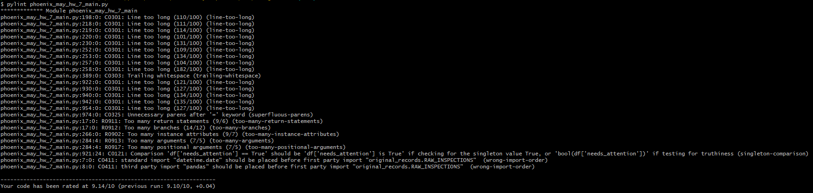
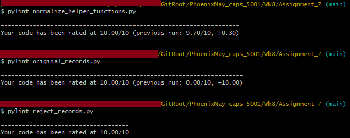

# Written Responses for Assignment 7

## Question 1: Does a module make sense here? Why?

I made multiple modules. First, I put the original RAW_INSPECTIONS records into a module called original_records. This makes sense because it's a long list that just takes up space in the main code body, and having it there makes it easier to accidentally modify it while working on the code. Putting it into a module keeps it safer from accidental changes.

I also put the ALL_REJECTS list (used for testing what audit_counts and clean_records do with a set of records where all are rejected) into its own module for the same reasons. Takes up a bunch of lines and it's easy to mess it up accidentally when working on the main code.

I also took the three helper functions for normalize_record (valid_hive_id, parse_date_ and convert_bool) and placed them into a module called normalize_helper_functions, which is abbreviated to nhf in the code. This makes sense because these are shorter functions that are called *within* the main normalize_record function but don't really need to be in the main code file. They take up extra space and can be relegated to a module with no ill effects. In my opinion, this also makes it easier to read through this section of code, since you don't have to look thru three helper functions before getting to normalize_record.

## Question 2: Include one sentence explaining why matching results from two implementations increases confidence but does not prove that either implementation is correct.

Matching results from two implementations makes it *less likely* that a mistake was made, since two different implementations achieved the same result, but it doesn't *prove* either is correct because they could both be wrong in the same ways.

## Question 4: What other analysis would make sense here? Find another library or tool that you think would help tell this data's story. Demonstrate using it in some way.

We've been summarizing everything by hive until now, but since we have dates, I wanted to summarize things by month to look for seasonal trends. I read the below StackOverflow discussion to learn more about tools in pandas for working with datetime data:

https://stackoverflow.com/questions/25146121/extracting-just-month-and-year-separately-from-pandas-datetime-column

And then I wrote a function called monthly_summary to display a summary by month and year. The summary includes average temperature, weight, mites, and risk score, as well as the percentage of inspections that need attention. The current data only has inspections in August, but over time, this information could be used to identify trends and give the user better insight as to whether issues are being caused by the time of year or something specific to a hive.

## Pylint

The main code body received a pylint score of 91.4%, seen below:

The modules (normalize_helper_functions.py, original_records.py, and reject_records.py) all received 100% scores, seen below:

## Other notes

The code produces three CSV files:

1. clean_records_df: shows all cleaned records including the needs_attention column.
2. needs_attention_df: shows only cleaned records needing attention and only the columns hive_id, inspection_date, mites, risk_score, and risk_reasons, per the instructions in Question #2.
3. changes_in_weight: shows changes in weight for Question #3. It only includes the hive_id, inspection_date, weight_lb, and wgt_incr_decr columns since those are the only relevant ones for seeing changes in weight.

Fixed the temp conversion issue from prior assignments. Removed a few of the larger pieces of output from the earlier assignments (things that printed entire lists/dictionaries, etc). I didn't remove any functions, just statements that printed all the old output, since the output was getting pretty long and those earlier pieces weren't relevant for this assignment.