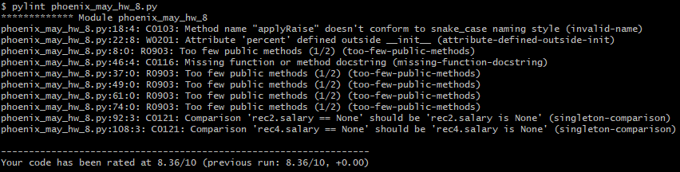
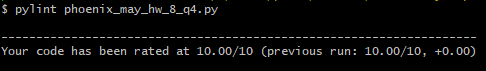

# CLASSES FOR ASSIGNMENT 8:

## Person

This class was created for question 1. It has the unique attributes "name," "job," and "pay". Job defaults to None and pay defaults to 0.

It has a method called applyRaise, which accepts an argument of "percent" and raises the pay attribute by that percent.

## Employee

This class (and all others) was created for question 2. It has the unique attributes "name" and "salary". Salary defaults to None.

It has a method called work, which prints the employee's name and the text "does stuff."

## Chef

This is an extension of the Employee class. It has the unique attribute "name". Chef salaries are automatically set to 50,000.

It has a method called work, which prints the chef's name and the text "makes food."

## PizzaRobot

This is an extension of the Chef class. It has the unique attribute "name". Some may debate whether robots should have names, but the assignment said its work method still needs to print a name, so these robots have names. They don't get paid, though, so salary is set to None.

It has a method called work, which prints the robot's name and the text "makes pizza."

## Server

This is an extension of the Employee class. It has the unique attribute "name". Server salaries are set to 40,000.

It has a method called work, which prints the server's name and the text "takes orders."

# Linting

The code for questions 1-3 got a score of 83.6%:

The code for question 4 got a score of 100%:
