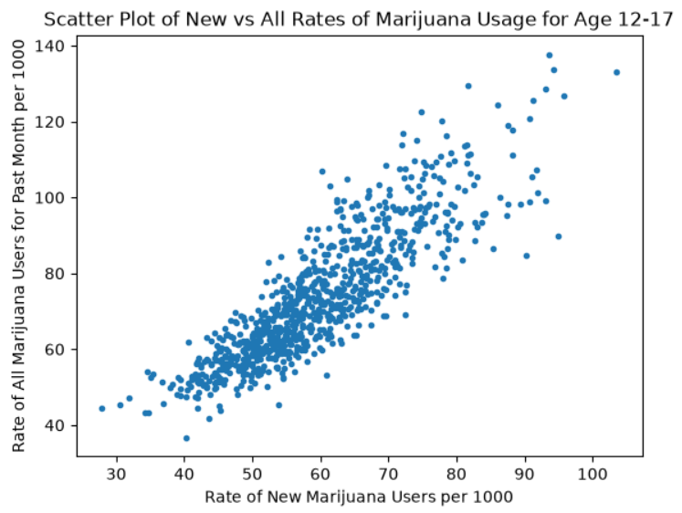

## 1: Dataset

I am going to use the below linked dataset about drug usage statistics. This contains substance abuse data for cigarattes, marijuana, cocaine, and alcohol for different age groups and different US states. It was collected during a study from 2002 to 2018. It has many columns, mostly numeric.

Drugs dataset taken from here: https://corgis-edu.github.io/corgis/csv/drugs/

## 2: Starting Hypothesis

With all the data given, there are a lot of options, but I'm thinking about doing this one:

Null hypothesis: For the drug usage dataset (containing substance abuse statistics across different US states/age groups/years), there will be **NO** difference between the mean yearly rate (per 1000 people & across all years/states) of new marijuana users for each age group.

Alternate hypothesis: For the drug usage dataset (containing substance abuse statistics across different US states/age groups/years), there **WILL** be a difference between the mean yearly rate (per 1000 people & across all years/states) of new marijuana users for each age group.

## 3: Models

To decide whether to reject the null hypothesis, a one-way ANOVA test would make the most sense, since the p-value would be able to tell me if it should be rejected. I plan on doing it at a significance level of 0.05 since that is the standard we've learned in my math course this semester.

But it wouldn't be any fun if that's ALL I did, so I could also produce side-by-side box plots for each age group, plotting rates on the y-axis, for a key visual.

I could also see if there's a correlation between rates of new marijuana users and rates of all current marijuana users. If so, I could create a linear regression model for each age group and compare the functions. This would shine more light on the question.

## 4: Visual

See below for a screenshot of a scatter plot showing rates of new and all marijuana users for 12-17 year-olds. I've also included the Jupyter Notebook file containing the code to produce it. It's useful because it can tell me if the idea I mentioned above, creating linear regression models for different age groups between rates of new users and all users, would be worthwhile. If there's a strong correlation then it would be worth investigating, but if it all looks totally random, maybe not.

It seems to show a strong positive relationship, meaning that higher rates new marijuana users are correlated with higher rates of total marijuana users at the 12-17 age group. It could be due to causation, like more people getting peer pressured into starting because their friends are doing it. Or maybe it's more because places with higher populations will just tend to have more people smoking weed and more people who want to start it. We can't say anything definitively, but the scatter plot shows it would be worth looking into.

